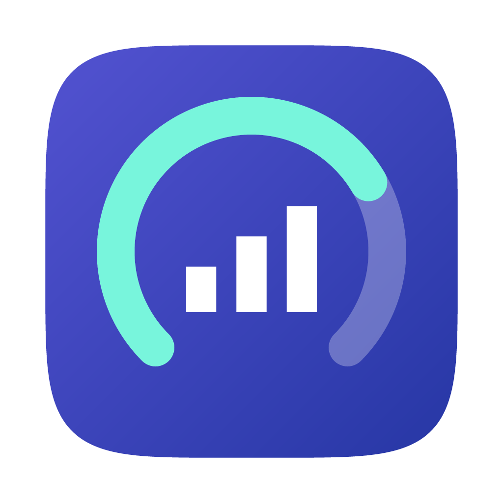
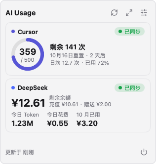
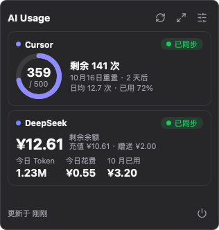
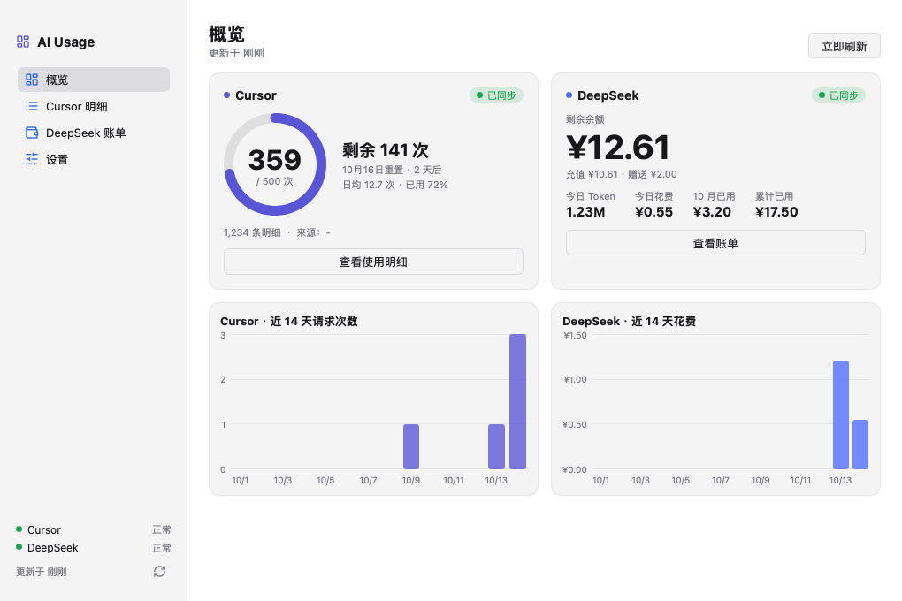
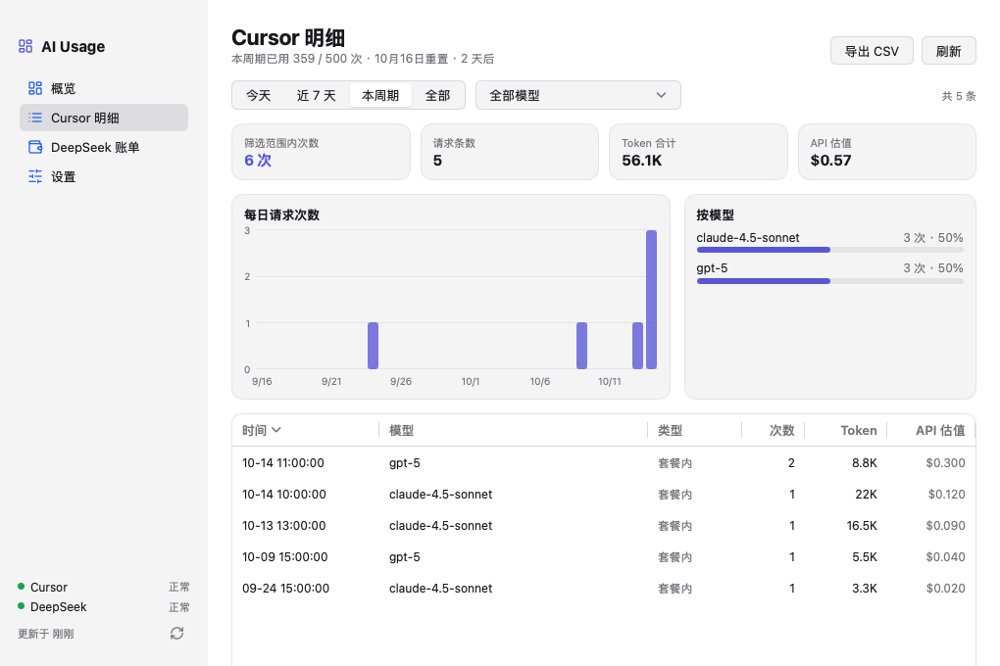
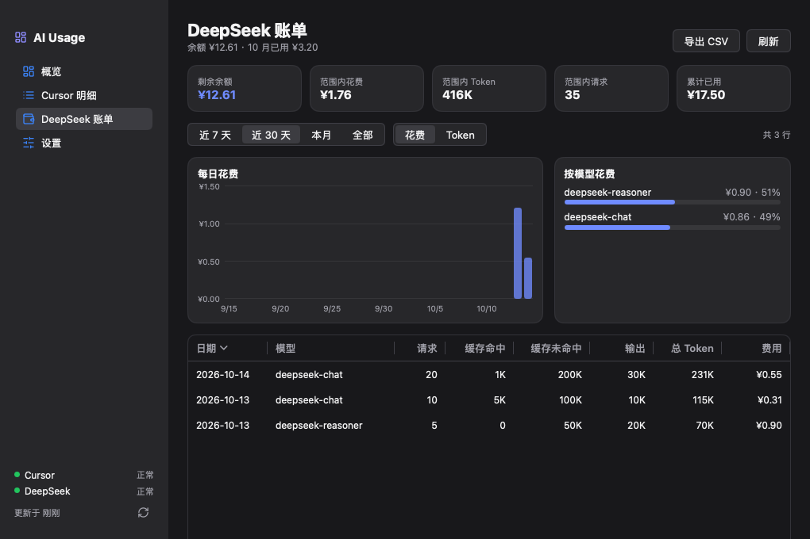
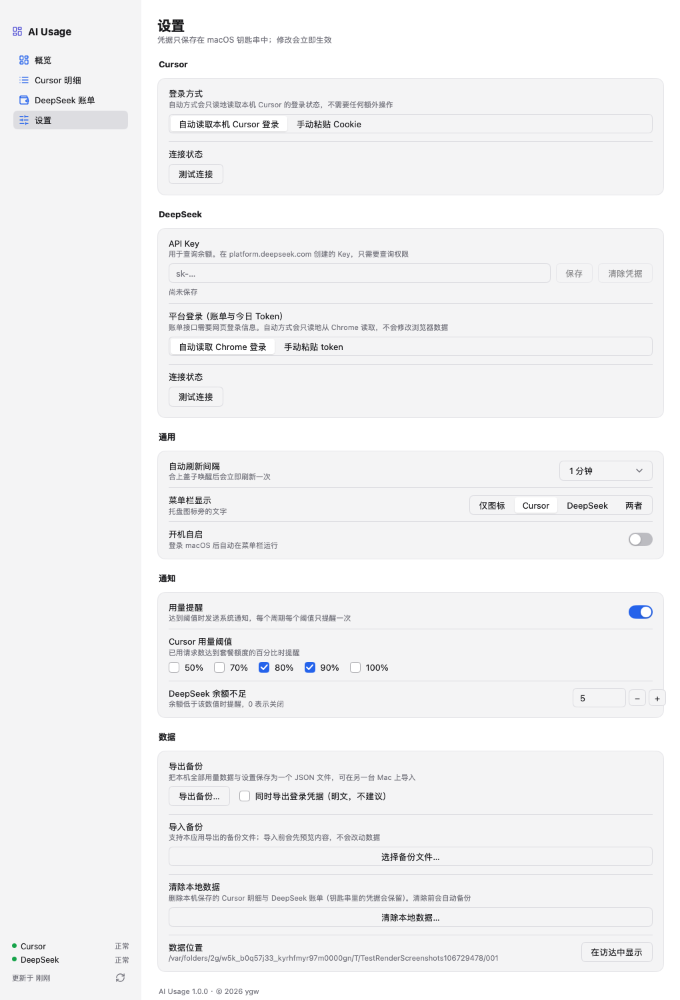

<div align="center">



# AI Usage

**macOS 菜单栏里的 AI 账单用量工具** —— 一眼看到 Cursor 还剩多少次请求、DeepSeek 还剩多少余额。

[](https://github.com/ixxxxoooo/ai-usage/actions/workflows/ci.yml)
[](https://github.com/ixxxxoooo/ai-usage/releases/latest)
[](LICENSE)


简体中文 · [English](README.en.md)

</div>

<p align="center">
  
  
</p>

## 为什么做它

- Cursor 老的 **500 次请求套餐** 要打开网页才能看用了多少、哪天重置；DeepSeek 要登录平台才能看余额与账单。
- AI Usage 常驻菜单栏，**点一下就是答案**；需要细看时展开成大面板，查看每一次请求和每日账单。
- 纯 Go + [MyGo](https://github.com/egoist/mygo) 原生 UI，**没有 WebView、没有 Electron**，安装包约 12 MB，内存占用小，外观跟随系统（浅色/深色、强调色、毛玻璃）。

## 功能

| 模块 | 能力 |
| --- | --- |
| **菜单栏** | 托盘文字可选：仅图标 / Cursor（如 `359/500`）/ DeepSeek 余额 / 两者；点击弹出紧凑浮窗，右键菜单 |
| **Cursor** | 本周期已用 / 剩余 / 重置日期 / 日均 / 预测用完日期；逐条请求明细（时间、模型、类型、次数、Token、API 估值），按时间/模型筛选、列排序、按日与按模型图表 |
| **DeepSeek** | 余额（充值 + 赠送）、今日 Token、今日花费、本月已用、累计已用；按日、按模型的账单表与图表（花费 / Token 切换） |
| **刷新** | 默认 **每 1 分钟** 自动刷新（可改 1–60 分钟）；合盖唤醒后立即刷新；离线时保留并标注上次数据；失败自动退避，被限流时遵守 `Retry-After` |
| **提醒** | Cursor 用量达到 50 / 70 / 80 / 90 / 100 % 时系统通知（每周期每阈值一次）；DeepSeek 余额低于设定值时通知 |
| **数据** | 全部数据保存在本机 SQLite；**导出 / 导入备份**（JSON，合并去重或覆盖、导入前预览、覆盖前自动备份）；明细可导出 CSV |
| **体验** | 浅色 / 深色自适应、毛玻璃、窗口位置与大小记忆（拔掉外接显示器也会回到可见区域）、开机自启 |

<details>
<summary>大面板截图（点击展开）</summary>

| 概览 | Cursor 明细 |
| --- | --- |
|  |  |

| DeepSeek 账单 | 设置 |
| --- | --- |
|  |  |

</details>

## 安装

### 下载安装包（推荐）

1. 到 [Releases](https://github.com/ixxxxoooo/ai-usage/releases/latest) 下载 `AI-Usage-<版本>.dmg`（Intel 与 Apple 芯片通用）。
2. 打开 DMG，把 **AI Usage** 拖进「应用程序」。
3. **首次打开**：安装包目前是 *ad-hoc 签名*（没有 Apple 开发者证书、未公证），macOS 会提示「无法验证开发者」。任选一种方式放行：
   - 在「应用程序」里 **右键 → 打开 → 打开**；
   - 或在终端执行：`xattr -dr com.apple.quarantine "/Applications/AI Usage.app"`。
4. 校验下载（可选）：`shasum -a 256 -c SHA256SUMS`（`SHA256SUMS` 在同一个 Release 里）。

> 系统要求：macOS 13 Ventura 或更新。

### 从源码构建

```bash
git clone https://github.com/ixxxxoooo/ai-usage.git
cd ai-usage
make build              # 当前架构，产物在 build/darwin-<arch>/
make build-universal    # Intel + Apple 芯片通用
```

只需要 Go（`go.mod` 指定的版本，`GOTOOLCHAIN=auto` 会自动下载）；MyGo 不依赖 cgo。更多见 [CONTRIBUTING.md](CONTRIBUTING.md)。

## 使用

1. 启动后菜单栏出现图标，**点击** 打开浮窗；浮窗右上角三个按钮依次是：立即刷新、展开大面板、设置；**右键** 图标有菜单。
2. **Cursor**：默认 *自动读取本机 Cursor 的登录状态*，不需要任何配置（要求本机装了 Cursor 并已登录）。读不到时，在「设置 → Cursor」选择 *手动粘贴 Cookie*。
3. **DeepSeek**：
   - 余额：在「设置 → DeepSeek」填入 API Key（只需查询权限）；
   - 账单与今日 Token：账单接口需要网页登录信息，默认 *自动从 Chrome 读取*（支持 Chrome / Edge / Brave / Arc / Vivaldi / Chromium 的各个 Profile），也可 *手动粘贴 token*。
4. 所有设置修改后立即生效，无需保存按钮。

## 隐私与安全

AI Usage **只在本机运行，没有任何服务端、没有统计和遥测**。完整说明见 [docs/PRIVACY.md](docs/PRIVACY.md)，要点：

- 网络请求只发往 `cursor.com`、`platform.deepseek.com`、`api.deepseek.com`，用于读取你自己的用量。
- 手动填写的凭据只保存在 **macOS 钥匙串**，不会写进数据库、日志或备份（备份里默认不含凭据，勾选才会导出，并有风险提示）。
- 读取 Cursor 本地登录与浏览器 localStorage 时 **全部只读**：Cursor 的 `state.vscdb` 以只读方式打开；浏览器数据先复制到临时目录再读，用完即删。
- 发现安全问题请按 [SECURITY.md](SECURITY.md) 私下报告。

## 数据在哪里

| 内容 | 位置 |
| --- | --- |
| 数据库（明细、账单、设置、快照） | `~/Library/Application Support/AI Usage/usage.db` |
| 窗口位置与大小 | `~/Library/Application Support/AI Usage/window-state.json` |
| 覆盖导入 / 清除前的自动备份 | `~/Library/Application Support/AI Usage/backups/`（保留最近 5 份） |
| 手动填写的凭据 | macOS 钥匙串 |

卸载：删除 `/Applications/AI Usage.app`，需要的话再删除上面的数据目录并在「钥匙串访问」里搜索 *AI Usage* 删除条目。

## 常见问题

<details>
<summary>Cursor 显示「未找到登录」？</summary>

确认本机已安装并登录过 Cursor（桌面版）。仍读不到时，在设置里改用「手动粘贴 Cookie」：登录 cursor.com，在浏览器开发者工具的请求头里复制 `Cookie`（形如 `WorkosCursorSessionToken=…`）。
</details>

<details>
<summary>DeepSeek 只有余额，没有今日 Token / 账单？</summary>

那些数据来自平台网页的接口，需要网页登录信息。请先在 Chrome 等浏览器登录 <https://platform.deepseek.com>，再点刷新；或在设置里手动粘贴 token。
</details>

<details>
<summary>用量和 Cursor 网页上不一致？</summary>

Cursor 网页的数字有缓存延迟；AI Usage 以官方用量接口为准，明细合计与之对账（见测试报告）。新版按 Token 计费的套餐没有「500 次」概念，本工具的额度环主要面向老的按请求计费套餐。
</details>

<details>
<summary>首次同步为什么要几十秒？</summary>

首次会拉取全部历史明细（几千条）。应用会先同步并保存本周期数据，界面马上可用，再在后台补更早的历史；之后每次只拉增量。
</details>

<details>
<summary>1 分钟刷新会不会被限流？</summary>

每次刷新只请求少量接口（增量明细 + 用量/余额），并带退避：失败后间隔会逐步拉长，被限流时遵守 `Retry-After`。仍担心可在设置里调大间隔。
</details>

## 开发

```bash
make test           # 全部测试（含 -race）
make vet            # go vet + mygo vet
make run            # 开发模式（热重载）
make live           # 用本机真实登录做只读联调
make shots          # 无头渲染各页面截图
```

目录结构与设计见 [docs/ARCHITECTURE.md](docs/ARCHITECTURE.md)；测试策略与最近一次结果见 [测试报告](.specstory/history/docs/20261014_测试报告.md)；备份格式见 [导出导入说明](.specstory/history/docs/20261014_导出导入.md)。

欢迎贡献！请先阅读 [CONTRIBUTING.md](CONTRIBUTING.md) 与 [行为准则](CODE_OF_CONDUCT.md)。版本变更见 [CHANGELOG.md](CHANGELOG.md)。

## 免责声明

AI Usage 是个人开源项目，**与 Cursor（Anysphere）、DeepSeek 没有任何关联**。它使用你自己的登录状态访问网页端使用的接口，这些接口没有公开承诺，可能随时变化而导致功能失效。请合理设置刷新频率，并遵守相关服务条款。

## 许可证

[MIT](LICENSE) © 2026 ygw
